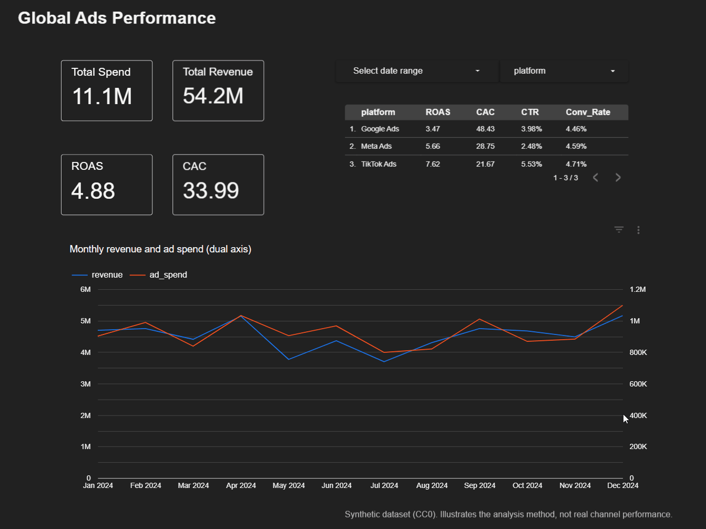
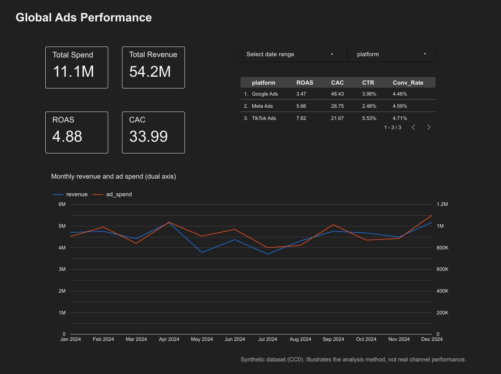
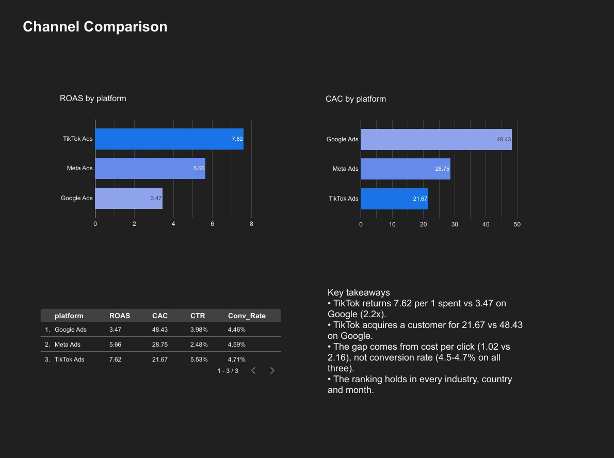
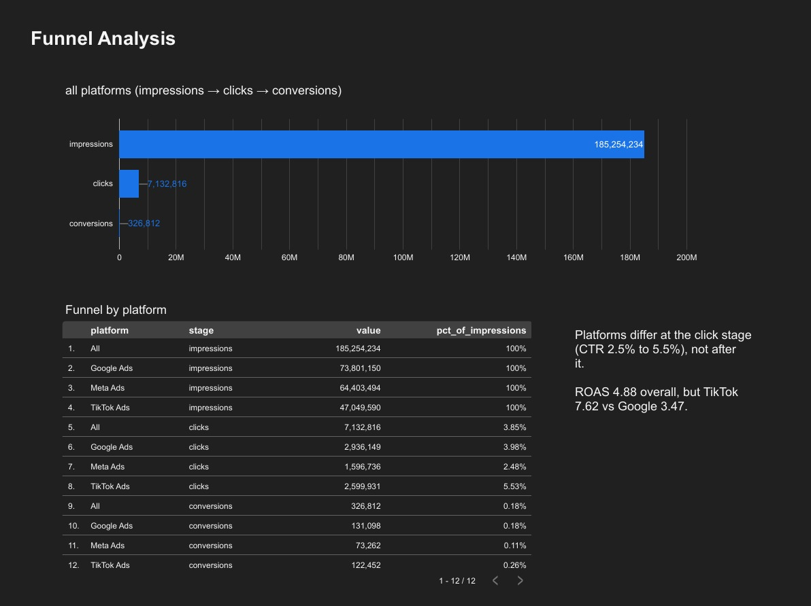
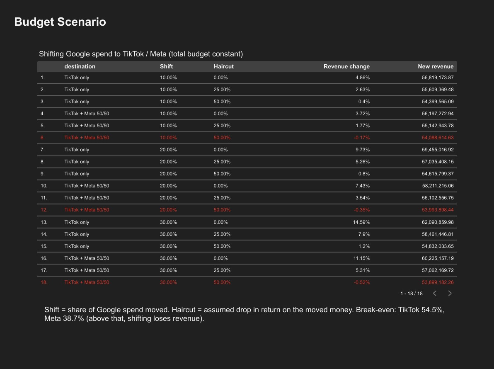

# Marketing / Ads Performance Analysis

**Which ad channel gives the best return, and how should the budget be reallocated?**

Channel efficiency, funnel loss and budget reallocation scenarios on Google, Meta and TikTok ad data. Analysis in Python, interactive dashboard in Looker Studio.



**Live dashboard:** [Global Ads Performance](https://datastudio.google.com/reporting/29bd15d9-3de1-4045-b0bd-42ba4d028193?hl=en)

**Status:** Complete

---

## Business Questions

1. Which channel has the lowest CAC?
2. How does ROAS differ by channel?
3. Where is the biggest drop-off in the funnel?
4. Which campaign type and segment perform best?
5. How should the budget be reallocated?

## Data

- **Source:** Kaggle, Global Ads Performance dataset
- **Scope:** Google Ads, Meta Ads, TikTok Ads; year 2024, monthly level
- **Note:** The dataset is **synthetic** (CC0). It illustrates the analysis method, not real channel performance.

## Approach

| Step | What | Notebook |
|---|---|---|
| 1. Data exploration | Structure, missing values, consistency checks | `01_data_exploration` |
| 2. Cleaning | Type conversions, date fields, `marketing_clean.csv` | `02_cleaning` |
| 3. Metrics and segment analysis | CTR, CPC, CAC, ROAS, conversion rate by platform, industry, country and campaign type | `03_metrics_analysis` |
| 4. Funnel and budget scenario | Impressions → clicks → conversions loss; budget shift scenarios | `04_funnel_budget` |
| 5. Dashboard | Looker Studio, 4 pages | - |

**Metrics**

| Metric | Formula |
|---|---|
| CTR | clicks / impressions |
| CPC | ad_spend / clicks |
| Conversion rate | conversions / clicks |
| CAC | ad_spend / conversions (= CPC / conversion rate) |
| ROAS | revenue / ad_spend |

## Dashboard

### Overview
Total Spend, Total Revenue, ROAS and CAC, with platform and date range filters and monthly revenue vs ad spend.



### Channel Comparison
ROAS and CAC by platform, with key takeaways.



### Funnel Analysis
Impressions → clicks → conversions, with a funnel table by platform.



### Budget Scenario
Scenarios for moving part of the Google budget to TikTok and / or Meta, with total budget held constant.



---

## Findings

1. **TikTok acquires the cheapest customers.** CAC: TikTok ~22, Meta ~29, Google ~48.
2. **TikTok returns the most per 1 spent.** ROAS: TikTok 7.62, Meta 5.66, Google 3.47.
3. **The gap is not random.** The same ranking holds in every industry, country and month.
4. **The gap comes from cost per click, not from conversion.** CPC is 1.02 (TikTok), 1.32 (Meta) and 2.16 (Google), so a TikTok click costs about half a Google click. Conversion rate is almost the same everywhere (4.5-4.7%).
5. **Platforms differ before the click, not after it.** CTR ranges from 2.5% (Meta) to 5.5% (TikTok). After the click, about 95% of visitors are lost on all three platforms.
6. **Campaign type, industry and season matter little.** The real difference comes from the platform.
7. **The one weak spot is the USA.** It has the lowest return on every platform and the largest share of spend.

| Platform | Spend share | Revenue share | ROAS |
|---|---|---|---|
| Google | 57% (6.35M) | 41% (22.0M) | 3.47 |
| Meta | 19% (2.11M) | 22% (11.9M) | 5.66 |
| TikTok | 24% (2.65M) | 37% (20.2M) | 7.62 |

## Business Impact

- **Move part of the Google budget to TikTok and Meta.** In the scenario model (total budget constant), moving 20% of Google spend raises revenue by roughly 4-10% if the moved money returns 75-100% of its current ROAS.
- **Expect diminishing returns on TikTok.** The shift still pays off until the return on moved money drops by 54.5% (TikTok) or 38.7% (Meta). Beyond that, shifting loses revenue.
- **Do it in steps.** Shift 10% first, measure the result, then continue if it holds.
- **Do not shut Google down.** It is the least efficient channel but produces 41% of revenue.
- **Review the USA budget.** It is the biggest spend with the lowest return.

## Notes and Limitations

- Ratios (CTR, CPC, CAC, ROAS, conversion rate) are calculated from totals, never averaged row by row. The mean row-level ROAS is 6.45, the true overall ROAS is 4.88.
- ROAS is revenue per unit of spend, not profit. Product cost and margin are not included.
- The `haircut` in the budget scenarios is an **assumption** about how much the return on moved money drops. It is not measured from the data, so the results should be read as a sensitivity analysis.
- The dataset is synthetic, so the findings should not be read as real channel performance. They illustrate the analysis approach.

## Repo Structure

```
marketing-ads-analysis/
├── data/
│   └── processed/        # cleaned and summary CSVs
├── notebooks/            # 01-04
├── dashboard/            # demo GIF and screenshots
├── reports/
└── README.md
```

The raw data is not included in the repo; it can be downloaded from Kaggle.

## Tools

Python (pandas, Jupyter), Looker Studio

## How to Run

1. Download the Global Ads Performance dataset from Kaggle and save it as `data/raw/global_ads_performance_dataset.csv`.
2. Run the notebooks in order: `01` → `04`.
3. The CSVs in `data/processed/` are the files uploaded to Looker Studio.
